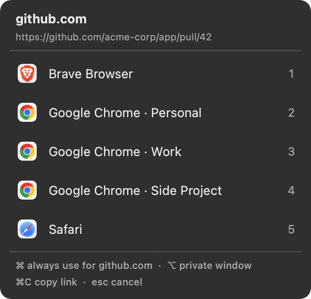
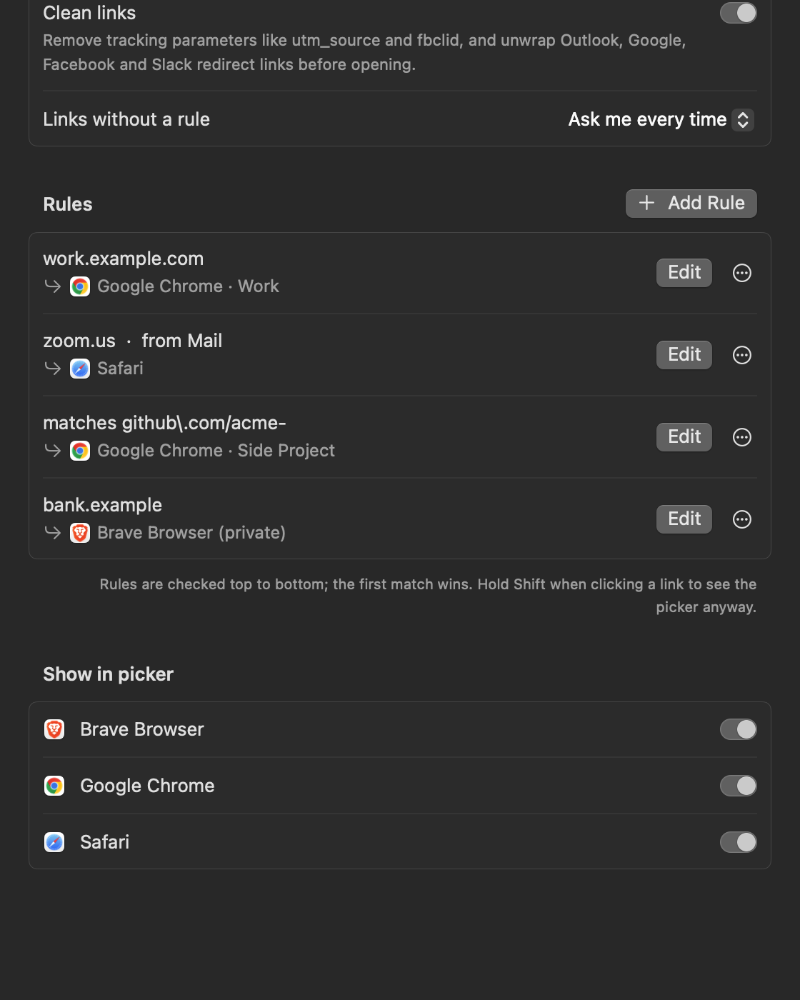
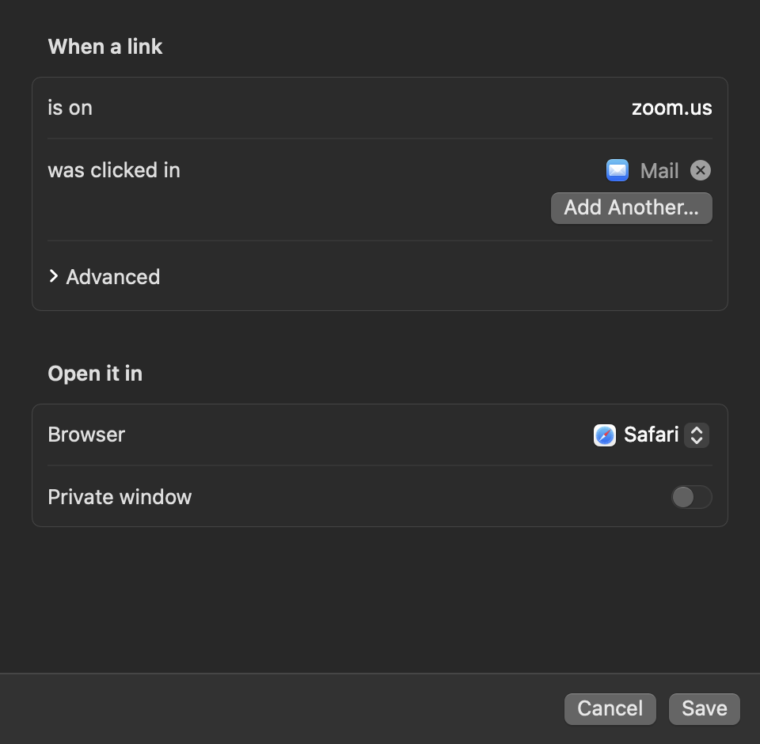

# Switchboard Browser Picker for Mac

**Open every link in the right browser, Chrome or Brave profile, or private window.** Switchboard is a free, open-source macOS menu-bar app that you set as your default browser. When you click a link in Slack, Mail, Notes or any other app, it either follows your rules or shows a quick browser picker at your cursor.

Use it to:

- open work links in your work Chrome profile and everything else in your personal one
- choose which browser opens a link each time you click it
- send Google Meet, Zoom or GitHub links to the browser you keep for them
- open links from a specific app (like Slack) in a specific browser or profile
- open some sites in a private or incognito window by default
- strip tracking junk like `utm_source` and `fbclid`, and skip Outlook SafeLinks and other redirect wrappers

**[Download Switchboard](../../releases/latest)** · [Website](https://dev.adityarajsingh.com/switchboard/) · [Compare Mac browser pickers](https://dev.adityarajsingh.com/switchboard/comparison/)

<p align="center">
  
</p>

## Features

- **Picker at the cursor.** Links without a rule open a small panel next to your mouse. Press `1`–`9` or click a row.
- **One row per profile.** Chrome, Brave, Edge, Vivaldi, Opera and Chromium profiles each get their own row.
- **Rules.** Send links to a browser by site, by URL pattern, or by the app you clicked them in.
- **Remember with ⌘.** Hold `⌘` while picking a browser to always open that site there.
- **Private windows.** Hold `⌥` while picking, or set a rule to always open privately (Chromium and Firefox families).
- **Link cleanup.** Removes tracking parameters (`utm_*`, `fbclid`, `gclid`, `msclkid` and more) and unwraps Outlook SafeLinks, Google, Facebook, Instagram, LinkedIn, Slack and YouTube redirect links before your rules run. On by default.
- **No account and no network access.** Your settings stay in one local JSON file. Link cleanup happens on your Mac and never looks anything up online.

## Install

1. Download `Switchboard.dmg` from the [latest release](../../releases/latest).
2. Open it and drag Switchboard into Applications.
3. The app is not notarized. Remove the quarantine flag once:
   ```bash
   xattr -dr com.apple.quarantine /Applications/Switchboard.app
   ```
4. Open Switchboard. Settings opens on first launch. Click **Make Default** and confirm the macOS prompt.

Requires macOS 14 Sonoma or later. Runs on Apple Silicon and Intel.

## Settings

Open Settings from the menu-bar icon (**Settings…**, `⌘,`), or open the app again from Finder.

<p align="center">
  
</p>

- **Clean links:** turn link cleanup on or off.
- **Links without a rule:** ask every time, or always use one browser or profile.
- **Rules:** add, edit, reorder and delete rules. Rules are checked top to bottom, and the first match wins.
- **Show in picker:** hide apps that registered for web links but aren't browsers.

Each rule matches on any mix of sites, source apps and a URL pattern. A rule matches only when all of its conditions match.

<p align="center">
  
</p>

## Picker shortcuts

| Key | Action |
| --- | --- |
| `1`–`9` | Open in that row |
| `Return` | Open in the first row |
| `⌘` + choice | Open there and always use it for this site |
| `⌥` + choice | Open in a private window |
| `⌘C` | Copy the link |
| `Esc` / click away | Cancel |

Hold `Shift` when you click a link to see the picker, even when a rule matches.

## Config file

Settings saves everything to `~/Library/Application Support/Switchboard/config.json`. Switchboard reads the file on every link, so hand edits apply at once.

```json
{
  "cleanLinks": true,
  "defaultTarget": null,
  "hiddenBrowsers": ["com.example.NotABrowser"],
  "rules": [
    { "hosts": ["work.example.com"], "open": { "browser": "com.google.Chrome", "profile": "Profile 1" } },
    { "urlPattern": "github\\.com/acme-", "open": { "browser": "com.google.Chrome", "profile": "Profile 2" } },
    { "hosts": ["zoom.us"], "sourceApps": ["com.apple.mail"], "open": { "browser": "com.apple.Safari" } },
    { "hosts": ["bank.example"], "open": { "browser": "com.brave.Browser", "private": true } }
  ]
}
```

- `hosts` matches the domain and all its subdomains. `example.com` also matches `www.example.com`.
- `urlPattern` is a case-insensitive regular expression, tested against the full URL.
- `sourceApps` lists the bundle IDs of the apps the link may come from.
- `profile` is the Chromium profile directory (`Default`, `Profile 1`, …), not its display name.
- `defaultTarget` opens unmatched links without the picker. Leave it `null` to always ask.
- `cleanLinks` removes tracking parameters and unwraps redirect links before rules match. Defaults to `true`.

To find an app's bundle ID, run `osascript -e 'id of app "Google Chrome"'`.

## Build from source

You need Xcode 16 or later (Swift 6).

```bash
git clone https://github.com/justadityaraj/switchboard-browser-picker.git
cd switchboard-browser-picker
./scripts/build.sh --install
```

`build.sh` runs the self-check and builds a universal release binary. It packages the app as `build/Switchboard.app`. `--install` copies it to `/Applications`, and `--release` also writes `build/Switchboard.dmg` and `build/Switchboard.zip`.

| Path | Contents |
| --- | --- |
| `Sources/SwitchboardCore` | Rule matching, config parsing, profile discovery and launch flags. No AppKit. |
| `Sources/Switchboard` | The app: menu-bar item, URL handling, picker and Settings. |
| `Sources/SwitchboardSelfCheck` | Checks for the core logic. Run with `swift run SwitchboardSelfCheck`. |

## License

[MIT](LICENSE)
